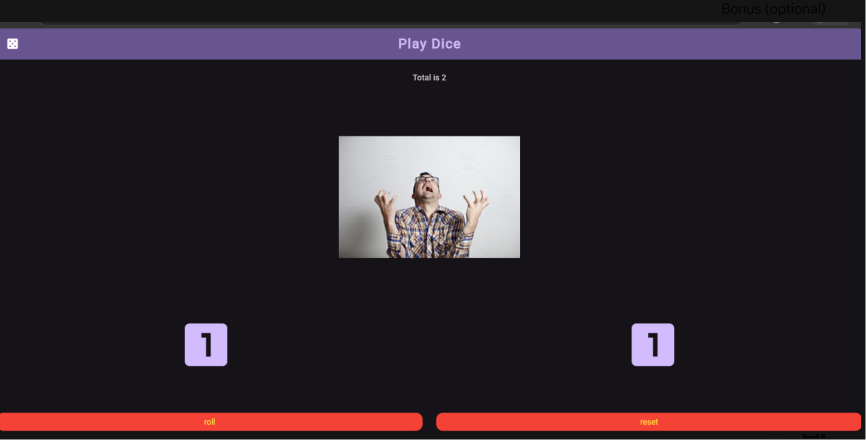

# Play Dice App

A Flutter application where the player rolls two virtual dice. If the combined total of the two dice is **10 or more**, a happy image and `"You Win"` are displayed. Otherwise, a sad image and `"You Lose"` are displayed.

## Screenshot



## Features

- **Roll Two Dice**: Generates two random numbers from `1` to `6` using `Random().nextInt(6) + 1` and updates the total score.
- **Dynamic Mood Image**: Displays `assets/happy.png` when `total >= 10`, or `assets/sad.png` otherwise.
- **Reusable `Dice` Widget**: Separate `StatelessWidget` in `lib/dice.dart` that receives a value (`1` to `6`) via its constructor and renders the corresponding Material `Icon` (`Icons.looks_one` to `Icons.looks_6`).
- **Reset Functionality**: Resets both dice to `1`, the total to `2`, and the image back to `assets/sad.png`.
- **Bonus Objectives Included**:
  - Dark theme using `brightness: Brightness.dark` inside `ColorScheme.fromSeed`.
  - Styled `roll` and `reset` buttons using `ElevatedButton.styleFrom(backgroundColor: ..., foregroundColor: ...)`.
  - Total text styled with `Theme.of(context).textTheme`.
  - Displays `"You Win"` or `"You Lose"` under the image.

## Project Structure

```text
├── assets/
│   ├── happy.png
│   ├── sad.png
│   └── screenshot.png
├── lib/
│   ├── dice.dart
│   └── main.dart
├── pubspec.yaml
└── README.md
```

## How to Run

1. Clone or download this repository.
2. Ensure you have the [Flutter SDK](https://docs.flutter.dev/get-started/install) installed.
3. Open a terminal in the project folder and fetch dependencies:
   ```bash
   flutter pub get
   ```
4. Run the app on a connected device, emulator, or web browser:
   ```bash
   flutter run
   ```

